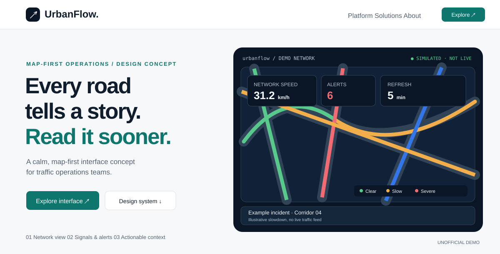

# TraffiCure-inspired UI Design Skill

**교통·공간정보·ITS·스마트시티 대시보드를 위한 Codex / Claude Code 디자인 스킬**

A reusable, **unofficial** UI design skill inspired by the public information architecture of [Lepton Software](https://leptonsoftware.com/) and [TraffiCure](https://leptonsoftware.com/trafficure/). Build an original, map-first traffic intelligence web experience, not a copy of the corporate site.

> **Disclaimer / 주의:** This is an independent design study, **not** Lepton Software's official design system. All HEX colors, fonts and CSS components are **original proposed tokens**, not verified or extracted official brand values. Fictional dashboard data is labeled DEMO. No affiliation or endorsement is implied.

[한국어 상세 사용법](README_KO.md) · [Skill 규칙](.agents/skills/trafficure-inspired-ui/SKILL.md) · [원본 사이트 분석](references/site-audit.md)

## Preview / 미리보기



[Open sample dashboard source](examples/dashboard.html) · [Color tokens](theme/tokens.css) · [Component CSS](theme/components.css)

## What's included / 주요 구성

| Path | Purpose |
|---|---|
| `.agents/skills/trafficure-inspired-ui/SKILL.md` | Codex-ready agent skill |
| `.claude/skills/trafficure-inspired-ui/SKILL.md` | Claude Code-ready agent skill |
| `theme/tokens.css` | Proposed colors, typography, spacing and radius |
| `theme/components.css` | Responsive layout, CTA, map shell, alerts and KPI cards |
| `examples/dashboard.html` | Original self-contained traffic analytics demo (uses local CSS) |
| `examples/preview.svg` | Illustrative preview rendered directly on GitHub |
| `references/site-audit.md` | Observed site patterns versus unverified visual attributes |
| `references/implementation-guide.md` | Reusable prompts and component specifications |
| `scripts/validate.py` | Basic structure and WCAG contrast checks |
| `AGENTS.md` | Repo-wide instructions for coding agents |

## Install / 사용 방법

**Option A — use within this repository:** Clone and open this repository as your Codex / Claude Code project; ask the agent to apply `trafficure-inspired-ui`.

**Option B — install as a global skill (Windows PowerShell):**

```powershell
# Run in the cloned repository root
Copy-Item -Recurse -Force .\.agents\skills\trafficure-inspired-ui "$HOME\.codex\skills\trafficure-inspired-ui"
Copy-Item -Recurse -Force .\.claude\skills\trafficure-inspired-ui "$HOME\.claude\skills\trafficure-inspired-ui"
```

Open the cloned project as well when you want the agent to resolve relative references to CSS and supporting documents.

**Example prompt**

> `trafficure-inspired-ui` 스킬을 사용하여 가상의 교통정보 관제 대시보드를 만들어줘. 도로망 중심 지도, 구간별 속도와 혼잡도, KPI 카드, 돌발 알림, 갱신 시각, 범례와 모바일 대응을 포함해줘. 예시 데이터는 DEMO로 명시해줘.

## Design principles

1. **Map-first:** geographic context before widgets.
2. **Evidence-led:** KPI units, time window, baseline and source.
3. **Operational severity:** labels + semantic color, not color alone.
4. **Clear hierarchy:** benefit-first hero, concise proof, single primary CTA.
5. **Accessible:** keyboard and WCAG contrast, responsive and reduced motion.
6. **Original work:** do not copy logos, original UI assets, official claims or site code.

## Design colors (interpretive, NOT official)

| Use | Color |
|---|---|
| Deep ink | `#101D2C` |
| Navy | `#0A1626` |
| Teal accent | `#0F766E` |
| Info / selection | `#3276EA` |
| Alert / critical | `#CF384B` |
| Background | `#F6F8FA` |

## Validate

```bash
python scripts/validate.py
```

## Source / License

Research date: **2026-11-06**. Primary source: [Official TraffiCure](https://leptonsoftware.com/trafficure/). Audit and verification limits: [site-audit.md](references/site-audit.md).

Original content is MIT-licensed; third-party trademarks and protected assets are not included.
